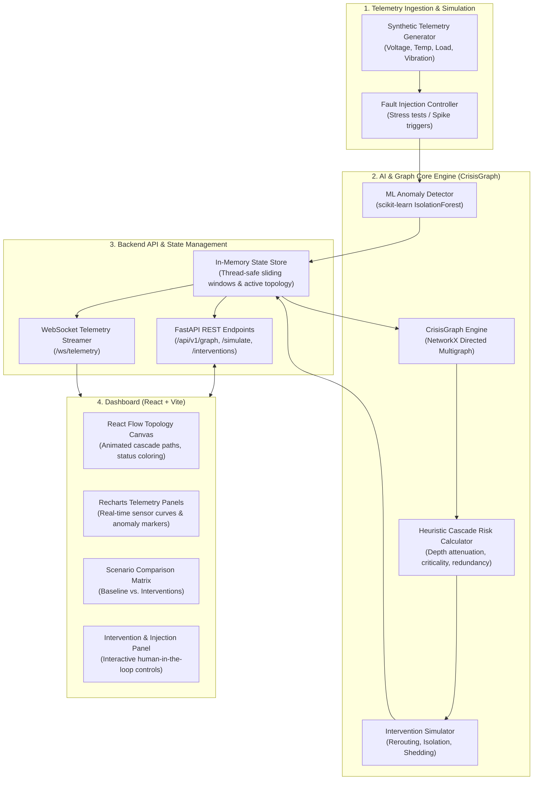

# SENTINEL Z — System Architecture

**Project**: SENTINEL Z — AI for Predicting Cascading Infrastructure Failures  
**Core Engine**: CrisisGraph  
**Theme**: Real-Time AI for Critical Decisions | IBM Z Datathon 2026  
**Target Environment**: Linux / IBM LinuxONE (s390x container-ready) & Modern Web Browsers  

---

## 1. Executive Summary & Problem Context

Modern urban centers operate on tightly coupled critical infrastructures: electrical power grids, water supply, transportation grids, communications, and emergency healthcare facilities. When a high-capacity electrical substation undergoes thermal runaway or catastrophic transformer breakdown, the failure does not remain isolated. Downstream communications hubs lose primary power, traffic management grids drop to failsafe or dark states, and emergency hospitals are forced onto backup diesel generators with finite runtimes.

**SENTINEL Z** provides an operational, real-time AI decision-support platform designed to:
1. Ingest continuous telemetry across interconnected infrastructure components.
2. Detect multivariate anomalous operational degradation via unsupervised machine learning (`IsolationForest`).
3. Project topological failure propagation using the **CrisisGraph** directed dependency engine.
4. Calculate transparent, deterministic risk scores and propagation paths.
5. Simulate and compare candidate mitigation interventions (load rerouting, selective component isolation, emergency backup dispatch) in real time before human operators execute irreversible decisions.

---

## 2. High-Level System Architecture



---

## 3. Component Deep Dive

### 3.1 Telemetry Generator & ML Anomaly Detection
- **Sensor Signals**: For each infrastructure node (Substation, Hospital, Traffic Hub, etc.), the generator produces:
  - `voltage_kv` / `voltage_v` (nominal ± noise)
  - `temperature_celsius` (thermal dynamics with cooling hysteresis)
  - `load_percentage` (dynamic utilization 0–100%+)
  - `vibration_frequency_hz` or `frequency_hz` (harmonic distortion indicator)
- **Model**: `scikit-learn.ensemble.IsolationForest`.
  - Trained on normalized baseline operating regimes.
  - Generates continuous decision function scores mapped to normalized anomaly scores $\in [0, 1]$.
  - Fast inference ($< 5\text{ms}$ per batch), suitable for s390x vector/in-memory processing.

### 3.2 CrisisGraph Dependency Engine
- Built on `NetworkX` as a directed attributed graph $\mathcal{G} = (\mathcal{V}, \mathcal{E})$.
- **Nodes $\mathcal{V}$**:
  - `type`: `substation`, `transformer`, `hospital`, `traffic_system`, `communication_hub`, `emergency_facility`
  - `criticality`: Priority weight $W_i \in [1.0, 5.0]$ (e.g., Level 1 Trauma Hospital = $5.0$, Local Traffic Signal = $1.5$)
  - `nominal_capacity`: Standard rated throughput (MVA, Gbps, etc.)
  - `backup_power`: Boolean flag indicating on-site generator or secondary redundant feed
  - `backup_fuel_hours`: Fuel capacity under islanded operation (e.g., 6h, 12h, 24h)
- **Edges $\mathcal{E}$**:
  - Directed edge $(u \rightarrow v)$ represents: *Node $v$ depends on Node $u$ for operational continuity.*
  - Attributes:
    - `dependency_type`: `power`, `telecom`, `operational_dispatch`
    - `coupling_strength`: $C_{uv} \in (0.0, 1.0]$ (how critically $v$ relies on $u$)
    - `redundancy_level`: $R_{uv} \in [0.0, 1.0]$ (attenuation factor if alternate feeds exist)
    - `transfer_capacity`: Max load transferable before tripping

### 3.3 Cascade Propagation & Risk Calculation
Failure propagation is modeled as an attenuated flow across directed paths.
For a source node $s$ experiencing anomaly severity $A_s \in [0, 1]$:
1. **Direct Failure Probability** $P_s = \min(1.0, A_s \times \text{HealthDeficit}_s)$.
2. **Propagated Impact to Downstream Node $d$ at distance $k$**:
   $$\text{CascadeImpact}(s \rightarrow d) = P_s \times \prod_{(u, v) \in \text{path}(s, d)} \left( C_{uv} \times (1 - R_{uv}) \times \gamma \right)$$
   Where:
   - $\gamma \in (0, 1)$ is the per-hop transmission damping factor (default $0.85$).
   - $R_{uv}$ is the redundancy mitigation factor (e.g. dual feed reduces transmission by $0.7$).
3. **Compound Downstream Risk Score**:
   $$\text{Risk}(d) = W_d \times \left( 1 - \prod_{p \in \text{Paths}(s, d)} (1 - \text{CascadeImpact}_p) \right)$$
   *Note: This transparent heuristic combines dependency coupling, hop distance, and component criticality without masquerading as an unverified real-world probabilistic forecast.*

### 3.4 Counterfactual Intervention Engine
Evaluates candidate mitigating actions against the baseline projected cascade:
1. **Load Rerouting**: Shift transfer load from strained edge $(u, v)$ to alternate edge $(u', v)$ within thermal headroom.
2. **Component Isolation / Controlled Islanding**: Trip edge $(u, v)$ immediately to prevent surge propagation to sensitive nodes (e.g., preserving emergency hospital equipment).
3. **Load Shedding**: Reduce non-essential consumer nodes (e.g., secondary traffic grids) by $X\%$ to stabilize the primary substation.
4. **Metric Comparison**:
   - $\Delta \text{Risk}$: Aggregate risk reduction across critical tier-1 nodes.
   - $\text{Collateral Impact}$: Number of non-critical nodes degraded by shedding/isolation.
   - $\text{Time-to-Cascade}$: Projected buffer time before critical threshold breach.

---

## 4. Frontend Architecture (React + Vite)

The UI is built with zero unnecessary third-party bloat, optimized for responsive real-time data binding:
- **Canvas View (`React Flow`)**: Custom nodes rendered with live status rings (green/amber/red), flashing cascade propagation paths, and selectable node inspection modals.
- **Telemetry Visualizer (`Recharts`)**: Real-time sliding window (last 60s) of sensor telemetry with anomaly bounding bands.
- **Intervention Workbench**: Interactive drawer to execute simulated actions and preview the counterfactual delta graph side-by-side.
- **State Synchronization**: WebSocket connection with automatic reconnection, heartbeat, and graceful fallback to HTTP polling `/api/v1/telemetry/latest`.

---

## 5. IBM LinuxONE Deployment Readiness

- **Platform Characteristics**: IBM LinuxONE (s390x mainframe architecture) excels at mission-critical transaction processing, high-density containerization, memory bandwidth, and pervasive security.
- **Container Architecture**:
  - Multi-stage Dockerfile adhering to OCI standards.
  - Base image: `python:3.11-slim` (s390x compatible wheels for NumPy, Pandas, scikit-learn).
  - Frontend compiled to static assets served directly via FastAPI static files or lightweight Nginx reverse proxy.
- **Memory Footprint**: Pure in-memory state store and lightweight graph traversal ensures $< 250\text{MB}$ total runtime memory footprint, enabling ultra-dense deployment on LinuxONE LPARs.

---

## 6. Directory Structure

```
sentinel-z/
├── backend/
│   ├── app/
│   │   ├── __init__.py
│   │   ├── main.py                    # FastAPI entrypoint & lifespan
│   │   ├── config.py                  # Environment & engine configuration
│   │   ├── api/
│   │   │   ├── __init__.py
│   │   │   ├── routes_graph.py        # Graph topology & node inspection
│   │   │   ├── routes_telemetry.py    # Sensor data & fault injection
│   │   │   ├── routes_simulation.py   # Cascade & intervention runs
│   │   │   └── websocket.py           # Real-time WebSocket handler
│   │   ├── core/
│   │   │   ├── __init__.py
│   │   │   ├── state.py               # In-memory thread-safe state store
│   │   │   └── scheduler.py           # Background simulation loop
│   │   ├── engine/
│   │   │   ├── __init__.py
│   │   │   ├── crisis_graph.py        # NetworkX graph topology & traversals
│   │   │   ├── risk_model.py          # Cascade propagation & risk calculations
│   │   │   └── interventions.py       # Counterfactual intervention simulator
│   │   ├── ml/
│   │   │   ├── __init__.py
│   │   │   ├── anomaly_detector.py    # IsolationForest wrapper & scoring
│   │   │   └── synthetic_generator.py # Sensor signal generator with noise/drift
│   │   └── models/
│   │       ├── __init__.py
│   │       ├── graph_models.py        # Pydantic models for nodes, edges, graph
│   │       ├── telemetry_models.py    # Sensor reading & injection schemas
│   │       └── simulation_models.py   # Cascade and intervention schemas
│   ├── tests/
│   │   ├── __init__.py
│   │   ├── test_crisis_graph.py       # Graph build & traversal tests
│   │   ├── test_anomaly_detector.py   # ML scoring & synthetic data tests
│   │   ├── test_risk_model.py         # Cascade risk calculation tests
│   │   ├── test_interventions.py      # Counterfactual intervention tests
│   │   └── test_api.py                # REST & WebSocket endpoint tests
│   ├── requirements.txt
│   └── Dockerfile
├── frontend/
│   ├── public/
│   │   └── favicon.svg
│   ├── src/
│   │   ├── assets/
│   │   ├── components/
│   │   │   ├── Header.jsx             # Status banner & global metrics
│   │   │   ├── TopologyGraph.jsx      # React Flow interactive canvas
│   │   │   ├── CustomNodes.jsx        # Custom node renderers for node types
│   │   │   ├── TelemetryPanel.jsx     # Recharts multi-signal charts
│   │   │   ├── CascadePathView.jsx    # Step-by-step cascade explanation
│   │   │   ├── InterventionPanel.jsx  # Scenario comparison & execution
│   │   │   ├── FaultInjector.jsx      # Manual stress & anomaly triggers
│   │   │   └── MetricCard.jsx         # KPI metric widgets
│   │   ├── services/
│   │   │   ├── api.js                 # Axios / fetch REST client
│   │   │   └── websocket.js           # Robust WebSocket manager with retry
│   │   ├── hooks/
│   │   │   └── useSystemState.js      # Global state hook
│   │   ├── styles/
│   │   │   └── index.css              # Modern CSS design system & animations
│   │   ├── App.jsx
│   │   └── main.jsx
│   ├── index.html
│   ├── package.json
│   └── vite.config.js
├── docs/
│   ├── architecture.md
│   ├── implementation_plan.md
│   └── api_contract.md
├── README.md
└── docker-compose.yml
```
